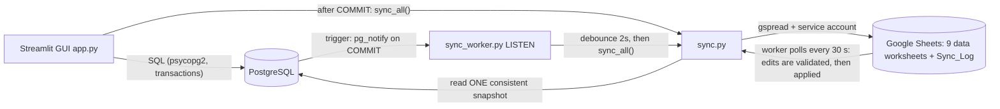
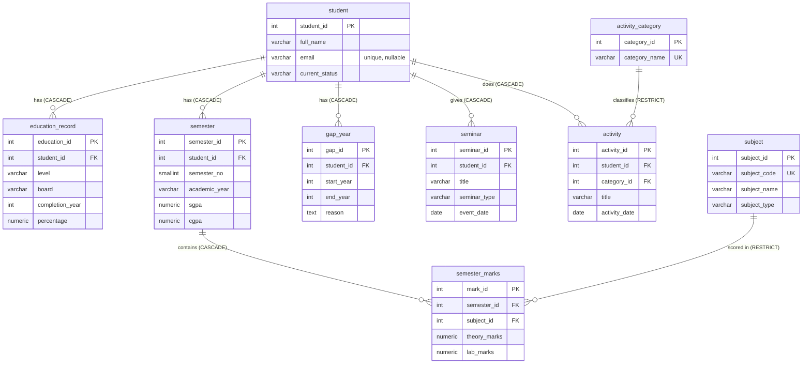

# StudentTrack – User Manual and Technical Report

## 1. Objective, problem and scope
**Problem:** a student's academic history (school results, semester marks, SGPA/CGPA, gap years, seminars, activities) usually lives in scattered paper files and spreadsheets, so it is duplicated, inconsistent and hard to chart.
**Solution:** a normalised PostgreSQL database with a Streamlit GUI (CRUD, search, progression charts, portfolio filters) that keeps a Google Spreadsheet automatically synchronised in both directions (database → sheet always; validated sheet edits → database).
**Scope:** per-student records from Secondary school to college semesters. *Out of scope:* login/roles, automatic SGPA/CGPA calculation (values are entered).

## 2. Architecture

Stack: PostgreSQL, Python 3.11+, psycopg2-binary, Streamlit, pandas, Plotly, gspread + google-auth, pytest.

## 3. ER diagram

(Three helper tables are not part of the academic model: `sync_status` = worker heartbeat; `sync_baseline` = what each worksheet looked like after the last sync, used to detect sheet edits; `sync_log` = every sheet edit applied or rejected.)

## 4. Constraints (all in `schema.sql`)
| Table | Keys / UNIQUE | CHECK | Delete rule |
|---|---|---|---|
| student | PK student_id; unique `lower(email)` where not null | name not blank; e-mail pattern; status ∈ {Studying, Graduated, Discontinued} | – |
| education_record | PK; UNIQUE(student_id, level) | level ∈ {Secondary, Higher Secondary}; percentage 0–100; year 1950–2100; board not blank | student → CASCADE |
| semester | PK; UNIQUE(student_id, semester_no) | semester_no 1–12; academic_year like `2023-24`; SGPA, CGPA 0–10 (NULL allowed) | student → CASCADE |
| subject | PK; UNIQUE(subject_code) | type ∈ {Theory, Lab, Both}; code/name not blank | – |
| semester_marks | PK; UNIQUE(semester_id, subject_id) | theory, lab 0–100 (NULL allowed); **trigger**: Theory subject ⇒ no lab marks, Lab subject ⇒ no theory marks | semester → CASCADE; subject → RESTRICT |
| gap_year | PK; UNIQUE(student_id, start_year, end_year) | years 1950–2100; end_year ≥ start_year | student → CASCADE |
| seminar | PK; UNIQUE(student_id, title, event_date) | type ∈ {Internal, External} | student → CASCADE |
| activity_category | PK; UNIQUE(category_name) | name ∈ {Technical, Co-curricular, Extra-curricular} | – |
| activity | PK; UNIQUE(student_id, category_id, title, activity_date) | title not blank | student → CASCADE; category → RESTRICT |

Indexes: `lower(full_name)` (name search), `lower(email)` unique, FK indexes on `semester_marks(subject_id)`, `activity(category_id)`, `activity(student_id)`, `gap_year(student_id)`; the UNIQUE constraints on (student_id, …) also index the other student FKs. NULL means "missing / not applicable" and is never treated as 0.

## 5. Normalisation to 3NF
**1NF** – every column holds one atomic value, every row is identified by a PK, no repeating groups (e.g. marks are rows in `semester_marks`, not columns `sub1, sub2, …`).
**2NF** – no partial dependency on part of a composite key. Tables use single-column surrogate PKs, and the natural composite keys are enforced as UNIQUE: in `semester_marks`, `(semester_id, subject_id) → theory_marks, lab_marks`; subject name depends only on `subject_id`, so it is in `subject`, not repeated per mark.
**3NF** – no non-key attribute depends on another non-key attribute. Functional dependencies:
- student_id → full_name, email, current_status
- (student_id, level) → board, completion_year, percentage
- (student_id, semester_no) → academic_year, sgpa, cgpa
- subject_id → subject_code, subject_name, subject_type (and subject_code → the same)
- (semester_id, subject_id) → theory_marks, lab_marks
- gap_id → student_id, start_year, end_year, reason
- seminar_id → student_id, title, seminar_type, event_date
- category_id → category_name; activity_id → student_id, category_id, title, activity_date

Anomalies prevented: *update* – a student name or subject name is stored once; *insert* – a subject can exist before any marks, a category before any activity; *delete* – deleting marks never deletes the subject, and ON DELETE RESTRICT stops deleting a subject/category that is in use. Design decision: percentage is stored (not derived from marks/max) because the brief asks for "marks or percentage"; SGPA/CGPA are stored because they are official declared results, so they are inputs rather than derived values.

## 6. GUI guide
Sidebar: page menu, **Find student** (type part of a name, any case) + **Selected student**, and worker status. Most pages work on the selected student.
1. **Dashboard** – KPIs and charts computed by SQL (students, semesters, average of each student's latest CGPA, seminars, activities, gap years).
2. **Student Management** – search table; *Add*; *Edit/delete* (delete needs a confirmation tick and removes all that student's data).
3. **Education Records** – Secondary / Higher Secondary (one each per student).
4. **Semester Records** – semester no., academic year `2023-24`, SGPA, CGPA (blank = not declared).
5. **Subject and Lab Marks** – *Subject catalogue* tab (add/edit/delete subjects) and *Marks* tab (theory/lab, blank = N/A; filter by semester).
6. **Academic Progression** – SGPA (solid) and CGPA (dashed) vs semester, axis 0–10, status shown, orange band = **recorded** gap year, grey dotted line = semester with **no record**; per-semester marks tables.
7. **Gap-Year Timeline** – timeline of semesters and gap years; add/edit/delete gap years.
8. **Seminars** – tabs All / Internal / External; add/edit/delete.
9. **Activities and Portfolio** – tabs per category, add/edit/delete, and *Academic records* (Secondary, Higher Secondary, semesters, all marks, status).
10. **Google Sheets Synchronization** – configuration check, worker status, two-way status, last sync result per worksheet, recent edits made in Google Sheets (applied/rejected), **Sync Now**.
Messages: green *"Saved in the database"* (the DB commit happened) is always shown separately from the sync message (📊 success / ⚠️ failed / ℹ️ not configured).

## 7. Synchronisation architecture
**Managed worksheets:** Students, Education, Semesters, Subjects, Subject_Marks, Gap_Years, Seminars, Activity_Categories, Activities, plus the read-only **Sync_Log**. Row 1 = column names (same as the DB columns; keys such as `student_id` link the worksheets exactly like the database), rows ordered by primary key, empty cell = NULL. Other worksheets in the file are never touched. Column details: `SHEET_COLUMNS.md`.

### 7.1 Database → Google Sheets (one-way, always on)
PostgreSQL is the source of truth. Each managed worksheet is compared with the database and, only if different, cleared and rewritten (never appended, so no duplicates; deletes propagate).
- **Path A – GUI:** `save()` in `app.py` → DB transaction commits → `sync.sync_all()` (never before the commit).
- **Path B – direct SQL (pgAdmin/psql):** statement-level triggers on all 9 tables call `pg_notify('studenttrack_changes', table)`. NOTIFY is transactional: delivered on COMMIT, dropped on ROLLBACK. `sync_worker.py` LISTENs, waits 2 s after the last notification (coalescing bursts), re-reads the committed state and syncs. No Google call happens inside the database. The worker writes a heartbeat every 10 s so the GUI can show 🟢/🔴, reconnects with back-off if PostgreSQL drops, and runs a catch-up sync on start.

### 7.2 Google Sheets → database (two-way, on by default, `TWO_WAY_SYNC=0` turns it off)
Google cannot push events to a local program, so the worker **polls**: every 30 s (`SHEET_POLL_SECONDS`) it reads the 10 worksheets (about 20 read calls/min, below Google's 60/min limit). Every sync run (poll, GUI save, Sync Now, direct-SQL notification) does **PULL first, then PUSH**, so a sheet edit is never overwritten before it has been examined.

**How an edit is recognised.** After every sync the database stores a *baseline* (`sync_baseline`) = what each worksheet contained. A sheet row that differs from its baseline row was edited by a person. Comparing with the baseline (not just with the database) also tells a person's edit apart from a database change.

**What happens to each kind of edit**
| You do this in the sheet | Result |
|---|---|
| Change a cell in an existing row | Validated like the GUI, then written with a normal UPDATE. If valid → saved; if not → reverted and logged. |
| Type a new row with an **empty ID cell** | Validated, INSERTed; the database assigns the ID, which appears on the sheet after the sync. |
| Clear a numeric cell (e.g. SGPA) | Saved as NULL (never 0). |
| Change an ID cell, or type a new row with an ID | Rejected: "IDs are assigned by the database". |
| Delete a row | **Not applied**; the row is restored (a stray keypress must not cascade-delete a student's data). Delete in the app or SQL. |
| Edit Activity_Categories or Sync_Log | Discarded (read-only). |
| Change the header row | That worksheet's edits are ignored. |
| Edit a row that also changed in the database since the last sync | Conflict: **the database value wins**, logged. |

**Strict validation (3 layers):** (1) `validation.py` – the same functions the GUI uses (ranges, formats, required fields, dates as `YYYY-MM-DD`, theory/lab vs subject type); (2) database constraints and triggers (CHECK, UNIQUE, FOREIGN KEY, NOT NULL) as the last line of defence; (3) nothing is committed unless both pass, and each row is its own transaction so one bad row never blocks the good ones. Rejections are written to `sync_log` and shown in the **Sync_Log** worksheet, on the GUI sync page and in the worker window. Date/year columns are set to *plain text* format in Sheets (once per process) so typing `2023-24` or `2023-02-14` is not auto-converted.

### 7.3 Reliability
Snapshot read in one REPEATABLE READ transaction; a PostgreSQL advisory lock plus an in-process lock prevent overlapping syncs; 429/5xx/network errors are retried (1.5 s, 3 s, 6 s); 401/403/404 fail immediately with an explanation; failures are never reported as success; unchanged worksheets cause zero write calls; the first sync after an upgrade creates the two new helper tables by itself.

## 8. Constraint violations and how they are handled
**Three lines of defence:** (1) the GUI validates input before any SQL and shows a yellow warning; dropdowns only offer existing records; (2) the database rejects anything that still gets through (the transaction is rolled back, nothing is saved) and `db.friendly_error()` turns the error into a readable message without exposing connection details; (3) edits typed into Google Sheets go through both of the above and are logged. Direct SQL gets PostgreSQL's own error text; the statement has no effect.

| Violation | Example | PostgreSQL error (pgAdmin/psql) | Message in the GUI / Sync_Log |
|---|---|---|---|
| CHECK – SGPA/CGPA range | `UPDATE semester SET sgpa=11` | violates check constraint "semester_sgpa_check" | SGPA must be between 0 and 10. |
| CHECK – marks range | theory marks 101 or -1 | violates check constraint "semester_marks_theory_marks_check" | Theory marks must be between 0 and 100. |
| CHECK – value list | status "Retired" | violates check constraint "student_current_status_check" | Status must be Studying, Graduated or Discontinued. |
| CHECK – format | e-mail "nope" | violates check constraint "student_email_check" | Email format is invalid. |
| CHECK – year order | gap 2022 → 2021 | violates check constraint "ck_gap_order" | End year cannot be before start year. |
| CHECK – academic year | `2023/24` | violates check constraint "semester_academic_year_check" | Academic year must look like 2023-24. |
| CHECK – not blank | name `'  '` | violates check constraint "student_full_name_check" | Full name cannot be blank. |
| Trigger – theory/lab mismatch | lab marks on a Theory-only subject | Subject is Theory-only: lab marks must be empty (NULL). | same text |
| UNIQUE | second student with same e-mail (any letter case) | duplicate key value violates unique constraint "uq_student_email" | Duplicate record: that email is already used by another student. |
| UNIQUE | semester 1 twice for one student | …"uq_semester_student_no" | Duplicate record: this student already has that semester number. |
| UNIQUE | same subject code twice | …"subject_subject_code_key" | Duplicate record: that subject code already exists. |
| FOREIGN KEY (child → parent) | semester for student 9999 | violates foreign key constraint "semester_student_id_fkey" | Invalid reference: the related record does not exist, or other records still depend on this one. |
| FOREIGN KEY (RESTRICT) | delete a subject that has marks, or a category with activities | violates foreign key constraint … on table "semester_marks" | same "Invalid reference…" message |
| NOT NULL | `INSERT INTO student(full_name) VALUES (NULL)` | null value in column "full_name" … violates not-null constraint | A required field was left empty. |
| Database unreachable | PostgreSQL stopped | connection refused | Cannot reach the database. Check that PostgreSQL is running… |
| Google unreachable / refused | no network, not shared | – | Database save is kept; warning "Google Sheets sync failed: …"; **Sync Now** retries. |

ON DELETE CASCADE is not an error: deleting a student silently removes their dependent rows (the GUI asks for confirmation first).

## 9. Modifying records directly in the database
Use pgAdmin (**Databases → studenttrack → right-click → Query Tool**, run with F5) or `psql`. The complete, tested tutorial is **`SQL_EXAMPLES.sql`** (it runs top to bottom and cleans up after itself). Essentials:
```sql
-- find IDs first
SELECT student_id, full_name FROM student WHERE full_name ILIKE '%priya%';

-- INSERT: never type an ID; look up parents by a unique value instead
INSERT INTO student (full_name, email, current_status) VALUES ('Demo Student','demo.student@example.com','Studying');
INSERT INTO semester (student_id, semester_no, academic_year, sgpa, cgpa)
SELECT student_id, 1, '2023-24', 8.2, 8.2 FROM student WHERE email = 'demo.student@example.com';

-- UPDATE: always with WHERE
UPDATE semester SET sgpa = 8.6, cgpa = 8.4
WHERE semester_no = 1 AND student_id = (SELECT student_id FROM student WHERE email = 'demo.student@example.com');

-- missing / not applicable = NULL (not 0)
UPDATE semester_marks SET lab_marks = NULL WHERE mark_id = 5;

-- DELETE: deleting a student cascades to all their records
DELETE FROM student WHERE email = 'demo.student@example.com';

-- undoable change
BEGIN;  UPDATE student SET full_name='Oops' WHERE student_id = 1;  ROLLBACK;   -- or COMMIT;
```
Rules: IDs are generated by the database (typing one is an error); invalid values are rejected by the constraints in §8; a change reaches Google Sheets within ~3 s after **COMMIT** when `sync_worker.py` is running (a rolled-back change never does). Do not edit `sync_baseline`, `sync_log` or `sync_status` by hand. For changes through the GUI see §6.

## 10. Testing – observed results (run in the development sandbox)
Environment: Ubuntu, Python 3.12, **PostgreSQL 16.15**, streamlit 1.66, gspread 6.2.1. **Not Windows. Google was simulated** by an in-memory object with gspread's method names, except for the manual checks listed in §11.

| Group | Result |
|---|---|
| Offline (`test_offline.py`): validation, progression logic, cell normalisation, retry, missing credentials/DB | 15 passed |
| Live PostgreSQL (`test_db_live.py`): brief items 1–14, category RESTRICT, theory/lab trigger, rollback, injection text, 8 violation messages | 28 passed |
| One-way sync + worker (`test_sync_live.py`): full sync, update/delete without duplicates, idempotency, unrelated sheet untouched, 403/503 reporting, overlap refusal, worker detects direct INSERT/UPDATE/DELETE, ROLLBACK not synced, burst coalescing, heartbeat, reconnect, cascade notified | 12 passed |
| **Two-way sync** (`test_twoway.py`): valid edits across 6 worksheets, blank→NULL, 18 kinds of invalid edit each rejected + reverted + logged, new valid/invalid rows, typed ID rejected, sheet-row delete restored, conflict (DB wins), header change, read-only sheets, no baseline, disabled mode, text formatting, row re-ordering is not an edit, worker polling applies a valid edit and rejects an invalid one | 39 passed |
| SQL tutorial (`test_sql_examples.py`): `SQL_EXAMPLES.sql` runs and cleans up; rollback example | 2 passed |
| GUI (`test_gui_live.py`, Streamlit AppTest): all 10 pages, KPIs, empty state, add student, invalid input, search, sync page | 16 passed |
| Real Google (`test_google_live.py`) | 1 skipped (needs credentials) |
Total: **112 passed, 0 failed, 1 skipped.** Mutation checks: deliberately breaking the pull, the conflict rule and the no-delete rule made the matching tests fail. The upgrade of an existing database + populated sheet was also exercised.

## 11. Implemented / tested / unverified
| Feature | Status |
|---|---|
| Schema, constraints, triggers, idempotent seed | Implemented + tested (PostgreSQL 16) |
| CRUD, search, validation, charts, portfolio filters | Implemented + tested headlessly |
| One-way sync (GUI and direct SQL via worker) | Implemented + tested; real-Google run on the student's own machine confirmed by the student (sheet populated; direct pgAdmin edit reached the sheet) |
| **Two-way sync logic** (detection, validation, conflict, logging, polling) | Implemented + tested against a **simulated** Sheets object |
| Two-way against the **real** Google API: reading edits, `Sync_Log` worksheet, TEXT formatting of date columns, behaviour when a human retypes a date in Sheets | **Unverified until demonstrated on real Google** (test procedure in README) |
| Windows execution, PostgreSQL 17/18 | Unverified by the author (the student ran 18 successfully for the one-way features) |

## 12. Limitations and future work
- Two-way: polling means a 0–30 s delay; an edit typed during the few seconds a sync is writing can be overwritten (retype it); row deletions are deliberately not accepted; sorting/filtering in Sheets is fine, but inserting a column or renaming a header makes that worksheet read-only for that sync.
- Full-refresh sync is fine for hundreds of rows, not for very large data; Google quotas are respected through idempotency (no writes when nothing changed) rather than rate limiting.
- SGPA/CGPA are typed in (could be computed from credits); no user login; gap years are stored as years, so their chart position is derived from the academic-year start; the GUI-triggered sync runs inside the user's request (a spinner is shown).
